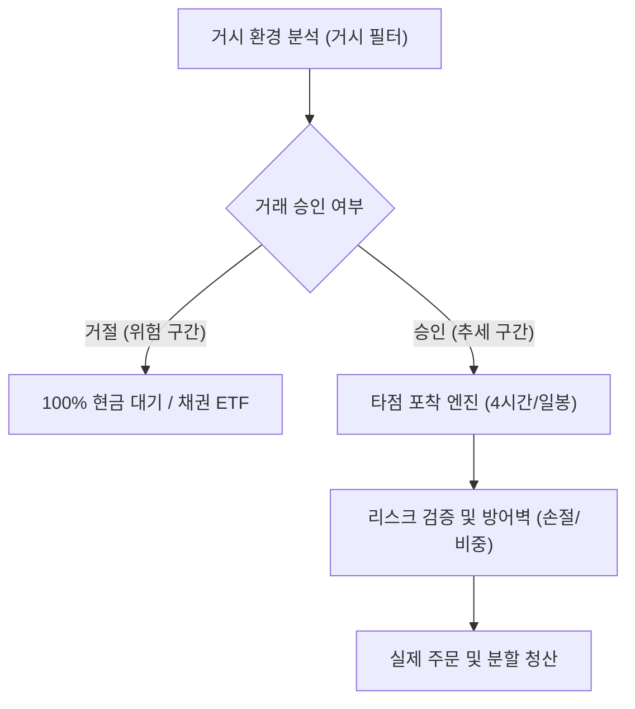

# 퀀트 스윙 트레이딩 시스템 아키텍처 기획서 (초안)
**문서 버전:** v1.0.0  
**작성 목적:** TQQQ, SOXX 등 미국 고변동성 레버리지 ETF 대상 스윙(1일~수주 보유) 매매 승률 65% 달성을 위한 시스템 아키텍처 및 전략 브레인스토밍

---

## 1. 최상위 설계 철학 및 목표

1. **초단타(스캘핑)의 철저한 배제**
   - 거래 수수료, 슬리피지(체결 오차), 주문 지연에 취약한 초단타를 배제하고, 일봉 및 4시간봉(240분봉) 중심의 여유 있는 스윙 매매 구조를 채택한다.
2. **레버리지 ETF의 치명적 결함(변동성 끌림) 극복**
   - 횡보장이나 하락장에서 기초자산보다 더 빠르게 가치가 훼손되는 레버리지 고유의 성질을 방어하기 위해 **"시장 거시 필터(Macro Filter)"가 승인할 때만 진입**한다.
3. **승률 65%를 위한 구조적 조건**
   - 무리한 고점 돌파 매매를 지양하고, **상승 추세가 확인된 종목이 일시적으로 과도하게 눌렸을 때 진입(추세 내 눌림목/평균 회귀)**하여 단기 반등 파동을 먹는 구조를 기본 축으로 삼는다.

---

## 2. 3대 에이전트 관점별 심층 브레인스토밍

### [관점 1: 전략 제안 (알파 발굴)]
- **시장 국면 필터링 (최상위 통제)**:
  - 미국 10년물 국채 금리가 급등세를 보이며 20일 이동평균선을 강하게 뚫고 올라가는 구간은 기술주/성장주에 쥐약이므로 자동 매수 금지.
  - 시장 공포 지수(VIX)가 25를 넘거나, VIX 단기 이동평균선이 상향 돌파될 때는 전면 거래 중단.
  - 나스닥/S&P500의 주봉이 20주선 위에 있는 '대세 상승장'에서만 레버리지 매수를 허용.
- **진입 타점 (4시간봉 눌림목)**:
  - 강한 상승 추세 도중 단기 악재나 숨고르기로 인해 가격이 볼린저 밴드 하단 또는 RSI 35 이하로 일시 진입한 뒤, 거래량을 동반하며 양봉으로 돌아설 때 1차 진입.
- **청산 로직**:
  - 목표 수익률 도달 시 50% 분할 익절, 나머지는 트레일링 스탑(이익 보전선 상향 추적)으로 수익 극대화.

---

### [관점 2: 리스크 비판 (클로드 관점의 냉철한 검증)]
- **비판 1: "하락장의 칼날 잡기" 위험**
  - 단순 과매도(RSI 30 이하) 진입은 2022년과 같은 대세 하락장에서 계속해서 손절을 유발하며 계좌를 반토막 낼 수 있음.
  - **보완책**: 가격 지표만 보지 말고, 거래대금과 주문 체결 강도를 함께 볼 것. 하락할 때 거래량이 줄어들고 반등 시 거래량이 실리는 **"매도세 소진(Exhaustion)"** 신호가 없으면 진입을 원천 차단해야 함.
- **비판 2: 손절 기준의 모호함**
  - 퍼센트(-3%, -5%)로만 손절을 잡으면 변동성이 큰 날 꼬리에 털리고 반등하는 휩소(Whipsaw)에 당함.
  - **보완책**: 해당 종목의 최근 변동폭(ATR, 평균 진폭)을 기반으로, 평소 변동폭의 1.5배~2배를 벗어나는 비정상 하락 시에만 손절선을 작동시키는 '동적 손절선' 도입 필요.

---

### [관점 3: 시스템 아키텍트 (코덱스 관점의 데이터/검증 설계)]
- **미래 참조 편향(Look-ahead bias) 완전 차단**:
  - 백테스팅 시 당일 종가를 미리 알고 장중에 진입하는 오류를 방지하기 위해, 모든 신호는 **봉 마감(Close) 시점에 확정되고 다음 봉 시가(Open)에 진입**하도록 엄격히 격리.
- **과최적화 방지 (전진 분석 파이프라인)**:
  - 2016~2020년 데이터로 최적화한 전략을, 성격이 완전히 다른 2022년 금리 인상 폭락장과 2023~2024년 AI 주도 급등장에 그대로 적용(Out-of-sample)하여 성과가 유지되는지 검증.
- **데이터 파이프라인 구성**:
  - 일봉/주봉 거시 데이터(FRED 연준 데이터, 야후 파이낸스, CBOE VIX)
  - 4시간봉 가격/거래량 데이터 수집기
  - 데이터 결측치 보정 및 이상치 필터링 모듈

---

## 3. 기존 방식을 뛰어넘는 혁신적 대안 아이디어 (Out-of-the-box)

1. **옵션 시장 스마트 머니 추적 (풋/콜 비율 & 감마 노출도)**:
   - 개별 주식 차트만 보면 바닥인지 알 수 없지만, 대형 기관들이 옵션 시장에서 풋옵션을 대량 청산하고 콜옵션으로 전환하는 지점(감마 플립)을 감지하면 승률 65%의 핵심 트리거가 됨.
2. **다크풀(Dark Pool) 대량 거래 지표 결합**:
   - 기관들의 장외 대량 체결 블록 주문이 특정 가격대에서 집중 매수로 잡힐 때, 이를 지지선으로 삼아 스윙 진입.
3. **정적 분할 매수가 아닌 켈리 기준(Kelly Criterion) 기반 변동성 베팅**:
   - 시장 환경이 좋을 때는 베팅 비중을 늘리고, 불확실성이 높을 때는 진입 비중을 계좌의 10% 미만으로 자동 축소하는 동적 자금 관리.

---

## 4. 향후 상세화 계획
- 2단계: 거시 필터 세부 수치 및 조건 조합 매트릭스 도출
- 3단계: 가짜 신호(Fake-out)를 걸러내기 위한 보조 트리거 상세화
- 4단계: 최종 종합 보고서(`morning_quant_proposal.md`) 완성
